# InstallRepo — instalação dos recursos do repositório

> **Escopo deste guia:** as ferramentas necessárias para trabalhar neste repositório — a **documentação** (vault no Obsidian, diagramas, exportação para Word, publicação do site) e a **solução .NET** (compilar, testar e levantar a API com o banco conectado).
> As seções 1 a 8 cobrem a documentação; a [seção 9](#9-rodar-a-solução-e-conectar-ao-banco) cobre a solução e a conexão com o banco.
>
> **Para as regras de edição do vault** (frontmatter, IDs, diagramas, ADRs), veja [`Agora.Docs/AGENTS.md`](Agora.Docs/AGENTS.md) — é a fonte única de verdade do processo.

## Índice

1. [Pré-requisitos](#1-pré-requisitos)
2. [Clonar o repositório](#2-clonar-o-repositório)
3. [Abrir o vault no Obsidian](#3-abrir-o-vault-no-obsidian)
4. [Plugins de comunidade](#4-plugins-de-comunidade)
5. [Instalar e configurar o Pandoc](#5-instalar-e-configurar-o-pandoc)
6. [Publicar o site (Quartz) — opcional](#6-publicar-o-site-quartz--opcional)
7. [Fluxo de trabalho Git](#7-fluxo-de-trabalho-git)
8. [Verificar se tudo funciona](#8-verificar-se-tudo-funciona)
9. [Rodar a solução e conectar ao banco](#9-rodar-a-solução-e-conectar-ao-banco)
10. [Referências](#10-referências)

---

## 1. Pré-requisitos

| Ferramenta | Versão | Para quê | Obrigatória? |
|---|---|---|---|
| [Git](https://git-scm.com/downloads) | qualquer versão atual | clonar o repositório, criar branches, abrir PRs | **Sim** |
| [Obsidian](https://obsidian.md/download) (desktop) | **≥ 1.13.1** | abrir o vault, ver diagramas, navegar por `[[wikilinks]]` | **Sim** |
| [.NET SDK](https://dotnet.microsoft.com/download/dotnet/10.0) | **10.x** (LTS) | compilar, testar e rodar a solução (`Agora.Api`) | **Sim** |
| [Neon](https://neon.tech) (conta) | plano gratuito | banco PostgreSQL gerenciado em nuvem — necessário p/ `dotnet test` | **Sim** p/ rodar os testes |
| [Pandoc](https://pandoc.org/installing.html) | 3.x | exportar notas para `.docx` (entregas da disciplina) | Não |
| [Node.js](https://nodejs.org) + npm | **Node 22.16.0** · npm ≥ 10.9.2 | sincronizar e buildar o site (Quartz) | Não |
| [GitHub CLI](https://cli.github.com) (`gh`) | qualquer versão atual | configurar o secret de publicação do site | Não |

> **Por que Obsidian ≥ 1.13.1?** É a versão mínima exigida pelo plugin PlantUML que o projeto usa (`.obsidian/plugins/obsidian-plantuml/manifest.json`). Com versão anterior, os diagramas PlantUML não carregam.
>
> **Por que Node 22?** O repositório do site fixa a versão em `.node-version` (`v22.16.0`) e declara `engines: node >= 22` no `package.json`.
>
> **Por que conta no Neon?** Os testes de integração conectam no banco de verdade — sem uma conta e uma senha configurada, `dotnet test` falha. Ver [seção 9.2](#92-conectar-ao-banco).

### Arquivos da raiz que dependem de apps externos

| Arquivo | Precisa de |
|---|---|
| `Agora.pptx` | PowerPoint, Keynote ou Google Slides |
| `Documento de Especificação.pdf` | qualquer leitor de PDF |

---

## 2. Clonar o repositório

```powershell
git clone https://github.com/Agora-s-Space/Social.Agora.git
cd Social.Agora
git branch --show-current
```

O comando `git branch --show-current` deve retornar `main`. A `main` é **protegida** (sem push direto) — todo trabalho acontece em branch curta e entra por PR.

Estrutura do repositório:

| Caminho | Conteúdo |
|---|---|
| `Agora.Docs/` | **o vault do Obsidian** — é esta pasta que você vai abrir no Obsidian |
| `Agora.Docs/.obsidian/` | configuração do vault (versionada, inclusive os plugins) |
| `.github/CODEOWNERS` | dono da documentação (`@TheSirLeaf`) — aprovação obrigatória de PR |
| `Agora.slnx` | solução .NET (formato XML) com os projetos de `src/` e `tests/` |
| `src/` | código da solução: `Agora.Api` (ASP.NET Core), `Agora.Domain`, `Agora.Infrastructure` (EF Core + Npgsql) |
| `tests/` | `Agora.Infrastructure.Tests` — testes de integração da conexão com o banco |
| `Directory.Packages.props` | versões centralizadas dos pacotes NuGet (toda a solução usa o mesmo número) |

---

## 3. Abrir o vault no Obsidian

1. Abra o **Obsidian desktop**.
2. **Open folder as vault** → selecione a pasta **`Agora.Docs`** (é ela que contém `.obsidian/`).
3. **Desative o "Modo Restrito" (Restricted mode)** em *Configurações → Plugins de comunidade*. Sem isso o Obsidian bloqueia a execução dos plugins de comunidade versionados no repositório.
4. Confirme em *Configurações → Plugins de comunidade* que **PlantUML** e **Pandoc Plugin** aparecem como ativos.
5. Comece por [`Agora.Docs/Home.md`](Agora.Docs/Home.md) — é o índice de navegação do vault.

**A configuração do vault já está versionada.** Não é preciso instalar os plugins pelo marketplace: os arquivos `.obsidian/plugins/obsidian-plantuml/` e `.obsidian/plugins/obsidian-pandoc/` vêm no clone. Se você instalou plugins do zero ou plugou o vault em outra conta do Obsidian, o caminho de configuração do Pandoc precisa ser corrigido — ver [seção 5](#5-instalar-e-configurar-o-pandoc).

> **Se você não tem o Obsidian Sync (plano pago)**, desative o plugin *Sync* em *Configurações → Plugins núcleo*. Ele vem ligado na configuração do vault.

### O que tem dentro do vault

| Pasta | Conteúdo |
|---|---|
| `01 Requisitos/` | visão, personas, RF / RNF / RN, casos de uso, LGPD |
| `02 Modelagem/` | domínio, ER, arquitetura, estados, fluxos, API, wireframes |
| `03 Decisões/` | ADRs + template |
| `04 Gestão/` | MVP, roadmap, backlog, glossário, deploy, custos |
| `VAULT/` | utilitários (template de nota, checklists, cheatsheets) |
| `Canvas/` | mapas visuais |
| `AGENTS.md` | **instruções de manutenção do vault** — leia antes de editar |

---

## 4. Plugins de comunidade

| Plugin | Versão no repo | Usado para | Só desktop? |
|---|---|---|---|
| `obsidian-plantuml` | 1.9.0 | diagramas de **classes, componentes, estados e use cases** | Não |
| `obsidian-pandoc` | 0.4.1 | **exportar** notas para `.docx`, `.epub` e `.pdf` | **Sim** |

### 4.1 PlantUML — diagramas

Diagramas PlantUML são blocos de código delimitados com `@startuml` / `@enduml` dentro de uma fence ` ```plantuml `:

````markdown

```plantuml
@startuml
class POST {
  +Guid Id
  +DateTime CriadoEm
}
@enduml
````

- **Requer internet.** O plugin usa por padrão o servidor público `https://www.plantuml.com/plantuml` — o texto do diagrama é enviado para fora da máquina. Para uso com dados sensíveis, configure um servidor PlantUML próprio nas settings do plugin (⚠️ não configurado neste repositório).
- Sem `@startuml`/`@enduml` o diagrama **não renderiza**.
- Referência de sintaxe: [`Agora.Docs/VAULT/Cheatsheet PlantUML.md`](Agora.Docs/VAULT/Cheatsheet%20PlantUML.md)

### 4.2 Pandoc — exportação

O plugin **não traz o Pandoc junto**: é preciso instalá-lo separadamente (seção 5). Sem isso, os comandos de exportação falham.

### 4.3 Mermaid — sem instalação

O Obsidian renderiza Mermaid nativamente (sem plugin, sem CLI externa). Usado para *sequence*, *flowchart*, *ER*, *gantt* e *mindmap*.
Referência: [`Agora.Docs/VAULT/Cheatsheet Mermaid.md`](Agora.Docs/VAULT/Cheatsheet%20Mermaid.md)

---

## 5. Instalar e configurar o Pandoc

Só é necessário se você for **exportar notas para Word/PDF** (ex.: a entrega `Documento de Especificação.md` → `.docx`).

### 5.1 Instalar

```powershell
# Windows (winget)
winget install --source winget --exact --id JohnMacFarlane.Pandoc

# ou baixe o instalador em https://pandoc.org/installing.html
```


Valide a instalação:

```powershell
pandoc --version
```

### 5.2 Apontar o caminho do executável

> ⚠️ **Atenção:** o caminho do Pandoc está versionado no git e aponta para a máquina de um colega (`C:\Users\patri\AppData\Local\Pandoc\pandoc.exe` em `.obsidian/plugins/obsidian-pandoc/data.json`). **Troque pelo caminho da sua máquina** antes de exportar — e evite commitar o seu caminho.

No Obsidian: *Configurações → Plugins de comunidade → Pandoc Plugin*.

| Campo | O que colocar |
|---|---|
| **Pandoc path** | executável `pandoc.exe` da sua instalação — no Windows padrão: `%LOCALAPPDATA%\Pandoc\pandoc.exe` |
| **pdflatex** | **deixar vazio** — não há LaTeX neste projeto; PDF via LaTeX não é usado |
| **Output folder** | opcional — vazio = exporta na mesma pasta da nota |
| **Extra arguments** | opcional — sem `--reference-doc` nem filtros configurados |

Depois, use a paleta de comandos do Obsidian (`Ctrl+P`) e procure por **Pandoc: Export pandoc**.

### 5.3 Conferir o resultado

Abra o `.docx` gerado no Word e verifique se os **wikilinks** saíram como texto legível. O plugin está configurado com `linkStrippingBehaviour: text` e `exportFrom: html` — é o comportamento esperado: os links `[[...]]` viram o texto do título.

---

## 6. Publicar o site (Quartz) — opcional

O site institucional (https://agora-s-space.github.io/Social.Quartz/) vive em **outro repositório**: [`Agora-s-Space/Social.Quartz`](https://github.com/Agora-s-Space/Social.Quartz) (Quartz v5, publicado via GitHub Pages). A automação que sincroniza o vault para ele **ainda não está ativa** — o estado das fases está em [`Agora.Docs/04 Gestão/Publicação do Site (Social.Quartz) — Pendências.md`](Agora.Docs/04%20Gest%C3%A3o/Publica%C3%A7%C3%A3o%20do%20Site%20%28Social.Quartz%29%20%E2%80%94%20Pend%C3%AAncias.md).

### 6.1 Rodar o site localmente

```powershell
git clone https://github.com/Agora-s-Space/Social.Quartz.git
cd Social.Quartz

npm ci                    # instala as dependências (usa o package-lock.json)
npx quartz plugin install # instala os plugins declarados em quartz.config.yaml
npx quartz build --serve  # build + preview local (http://localhost:8080)
```

Comandos úteis:

| Comando | O que faz |
|---|---|
| `npm run sync` | copia para `content/` as notas do vault Agora que têm `publish: true` |
| `npm run check` | `tsc --noEmit` + verificação de formatação (Prettier) |
| `npm run format` | formata o código do site |
| `npm run quartz -- <cmd>` | executa a CLI do Quartz |

### 6.2 Regra de publicação

Só entram no site as notas que têm **`publish: true` no frontmatter** (plugin `explicit-publish` do Quartz). Notas sem essa propriedade não são publicadas, mesmo que estejam no vault.

### 6.3 Publicar alterações

Um push na `main` do `Social.Quartz` dispara o GitHub Actions (`.github/workflows/deploy.yml`), que reconstrói e publica o site. Localmente:

```powershell
git add -A
git commit -m "docs: atualizar conteúdo"
git push origin main
```

### 6.4 Secret de automação (mantenedores)

A sincronização automática vault → site usa um *fine-grained PAT* com acesso **somente** ao `Social.Quartz`, permissão `Contents: Read and write`. O secret é gravado no repositório do Agora:

```powershell
gh auth login
gh secret set SYNC_PAT -R Agora-s-Space/Social.Agora
```

⚠️ O token expira a cada **90 dias** — renová-lo é uma tarefa recorrente da equipe.

---

## 7. Fluxo de trabalho Git

| Item | Regra |
|---|---|
| Branch principal | `main` — **protegida**, sem push direto |
| Branches de trabalho | curtas e descritivas: `feat/...`, `docs/...`, `chore/...`, `fix/...` |
| Convenção de commit | **Conventional Commits** — `feat:`, `fix:`, `docs:`, `chore:`, `refactor:`, `test:` |
| Code review | PR para `main` com **≥ 1 aprovação** obrigatória |
| Quem aprova | `.github/CODEOWNERS`: qualquer PR que toque `Agora.Docs/` exige aprovação de `@TheSirLeaf` |
| Merge | PR aberto · ≥ 1 aprovação · sem conflitos · commit padronizado |

Fluxo típico:

```powershell
git switch main
git pull
git switch -c docs/meu-tema
# ... editar ...
git add -A
git commit -m "docs: descreve o que foi alterado"
git push -u origin docs/meu-tema
```

Depois abra o PR no GitHub (`gh pr create --fill`) e aguarde a aprovação.

> **Se a sua PR altera uma nota do vault**, siga também o checklist de `Agora.Docs/AGENTS.md` (frontmatter completo, `[[wikilinks]]`, diagramas renderizando).

---

## 8. Verificar se tudo funciona

### 8.1 Checklist

- [ ] O Obsidian abre `Agora.Docs` sem erro e o **Modo Restrito** está desativado
- [ ] `Home.md` é o arquivo aberto por padrão e os `[[wikilinks]]` navegam com `Ctrl+clique`
- [ ] O frontmatter das notas aparece no painel **Properties** (tags, tipo, status, atualizado)
- [ ] Um diagrama **Mermaid** renderiza (nativo) — ex.: `02 Modelagem/Modelo de Dados (ER).md`
- [ ] Um diagrama **PlantUML** renderiza (ex.: `02 Modelagem/Modelo de Domínio.md`) — exige internet
- [ ] `pandoc --version` responde no terminal e um export de teste gera `.docx` válido
- [ ] `dotnet build` compila a solução sem erro
- [ ] Com a API no ar, `curl http://localhost:5286/health` responde `{"status":"online","database":"ok"}` ([seção 9.3](#93-health-check))

### 8.2 Problemas comuns

| Sintoma | Causa provável | Solução |
|---|---|---|
| PlantUML e Pandoc não aparecem na lista de plugins | Modo Restrito ativo | *Configurações → Plugins de comunidade* → desative o modo restrito |
| Export para `.docx` falha / "pandoc not found" | caminho do Pandoc não configurado na sua máquina | corrigir o campo **Pandoc path** ([seção 5.2](#52-apontar-o-caminho-do-executável)) |
| Diagrama PlantUML não renderiza | sem internet (servidor público) ou falta `@startuml`/`@enduml` | testar a internet; conferir as fences |
| Obsidian pede login do Sync | plugin *Sync* nativo vem habilitado | *Configurações → Plugins núcleo* → desabilitar *Sync* |
| `[[link]]` não resolve para uma nota | nome do arquivo contém `:`, `\` ou `/` | renomear o arquivo (ver `VAULT/Template - Nova Nota.md`) |
| Nota não aparece no site | falta `publish: true` no frontmatter | adicionar a propriedade ([seção 6.2](#62-regra-de-publicação)) |
| `npm ci` falha no site | versão de Node/npm abaixo do exigido | usar Node 22.16.0 e npm ≥ 10.9.2 ([seção 1](#1-pré-requisitos)) |
| A API sobe mas o `/health` responde `404` | você está na porta errada — a API usa a **5286** | usar `http://localhost:5286` (perfil `http` do `launchSettings.json`) |
| Erro `'<profile>:Password' nao configurado` | a senha do banco não foi gravada | `dotnet user-secrets set "DatabaseCloud:Password" "<senha>" --project src\Agora.Api` ([seção 9.2](#92-conectar-ao-banco)) |
| `dotnet test` falha com erro de conexão | os testes de integração batem no banco real — sem senha ou sem internet eles não passam | gravar a senha e checar a internet; para pular os testes de integração, filtrar pelo trait `Categoria=Integracao` |

---

## 9. Rodar a solução e conectar ao banco

> A solução .NET já existe no repositório (`Agora.slnx`) e já conversa com o banco. Docker, entidades, migrations e CI **ainda não** — ver [seção 9.4](#94-o-que-ainda-não-existe).

### 9.1 Compilar e rodar

```powershell
dotnet build
dotnet test
dotnet run --project src\Agora.Api
```

Todos os projetos são `net10.0` — por isso o SDK 10 é obrigatório.

| Projeto | Papel |
|---|---|
| `src/Agora.Api` | ASP.NET Core Web API — expõe o endpoint `/health` |
| `src/Agora.Domain` | núcleo de domínio, sem dependências externas |
| `src/Agora.Infrastructure` | EF Core + Npgsql: `AgoraDbContext`, opções de conexão e DI |
| `tests/Agora.Infrastructure.Tests` | testes de integração da conexão (xUnit + Coverlet) |

As versões dos pacotes ficam centralizadas em `Directory.Packages.props` — para trocar a versão de algo, edite só esse arquivo:

| Pacote | Versão |
|---|---|
| `Npgsql` · `Npgsql.EntityFrameworkCore.PostgreSQL` | 10.0.3 |
| `Microsoft.EntityFrameworkCore` (+ `.Design`) | 10.0.4 |
| `Microsoft.Extensions.Configuration.*` | 10.0.12 |
| `xunit` · `xunit.runner.visualstudio` | 2.9.3 · 3.1.4 |
| `coverlet.collector` | 6.0.4 |

### 9.2 Conectar ao banco

A configuração fica em `src/Agora.Api/appsettings.json`. A chave `DatabaseProfile` escolhe qual das duas seções é usada:

| Chave | Efeito |
|---|---|
| `DatabaseProfile: "DatabaseCloud"` | usa a seção `DatabaseCloud` — **é o padrão** |
| `DatabaseProfile: "DatabaseLocal"` | usa a seção `DatabaseLocal` (Postgres local) |
| `DatabaseProfile` ausente | assume `DatabaseCloud` |

```json
  "DatabaseProfile": "DatabaseCloud",
  "DatabaseCloud": {
    "Host": "<host do Neon>",
    "Port": 5432,
    "Database": "<banco>",
    "Username": "<usuário>",
    "Password": "",
    "SslMode": "Require",
    "MaximumPoolSize": 10
  },
  "DatabaseLocal": {
    "Host": "localhost",
    "Port": 5432,
    "Database": "agora",
    "Username": "agora",
    "Password": "",
    "SslMode": "Disable",
    "MaximumPoolSize": 10
  }
```

> ⚠️ O console do Neon entrega a conexão no formato **URI** (`postgresql://…`), e o Npgsql **não** aceita esse formato. A aplicação usa os campos discretos acima e monta a connection string no formato keyword/value — copie os valores campo a campo.

A senha **nunca** é versionada. Grave a sua localmente com user-secrets:

```powershell
dotnet user-secrets set "DatabaseCloud:Password" "<sua senha>" --project src\Agora.Api
dotnet user-secrets set "DatabaseLocal:Password" "<sua senha>" --project src\Agora.Api

# conferir o que está gravado
dotnet user-secrets list --project src\Agora.Api
```

- O valor do user-secrets **sobrescreve** o `appsettings.json`.
- A API e o projeto de testes compartilham o mesmo `UserSecretsId`, então gravar uma vez serve para `dotnet run` **e** para `dotnet test`.
- Sem a senha, a aplicação falha na inicialização com o erro `'<profile>:Password' nao configurado`.
- ⚠️ Nunca commite senha, connection string ou o arquivo `secrets.json`.

> **Os testes de integração conectam no banco de verdade** (não usam mock): o `CanConnect` e o `SELECT 1` batem no Postgres configurado. Sem senha e sem internet, `dotnet test` falha.

### 9.3 Health check

Com a API no ar, o `/health` confirma a conexão em tempo real:

```powershell
curl http://localhost:5286/health
```

| Situação | Resposta | HTTP |
|---|---|---|
| Conectando no banco | `{"status":"online","database":"ok"}` | 200 |
| Sem conectar | `{"status":"offline","database":"inacessivel"}` | 503 |

A porta é a **5286** (perfil `http` do `launchSettings.json`); o perfil `https` usa `https://localhost:7283` + `http://localhost:5286`. ⚠️ O README do repositório cita a porta `5000` — a porta real da API é a **5286**.

### 9.4 O que ainda não existe

| Recurso | Situação atual | Documentação |
|---|---|---|
| Docker + Ubuntu LTS 24.04 na VPS | decidido, ainda não provisionado | [`ADR-010`](Agora.Docs/03%20Decis%C3%B5es/ADR-010%20Sistema%20Operacional%20da%20VPS%20%28Linux%29.md) |
| Entidades, schema e migrations | `AgoraDbContext` criado, **sem entidades** — migrations entram na branch de cadastro | [`ADR-003`](Agora.Docs/03%20Decis%C3%B5es/ADR-003%20Persist%C3%AAncia.md) |
| Banco do servidor (PostgreSQL) | conectado via Npgsql em nuvem (Neon) | [`ADR-007`](Agora.Docs/03%20Decis%C3%B5es/ADR-007%20Banco%20do%20Servidor%20%28Npgsql%29.md) |
| CI (build + testes) | **não existe** nenhum workflow no repositório | [B-09 no backlog](Agora.Docs/04%20Gest%C3%A3o/Backlog%20do%20Produto.md) · RNF-14 |
| Cliente desktop (Avalonia) | decidido, projeto ainda não criado | [`ADR-001`](Agora.Docs/03%20Decis%C3%B5es/ADR-001%20Stack%20Tecnol%C3%B3gica.md) |
| `global.json` / `.editorconfig` | não existem — o SDK não é pinado por arquivo | — |

---

## 10. Referências

- Vault / navegação: [`Agora.Docs/Home.md`](Agora.Docs/Home.md)
- Regras de manutenção do vault: [`Agora.Docs/AGENTS.md`](Agora.Docs/AGENTS.md)
- Resumo dos requisitos: [`Agora.Docs/Resumo dos Requisitos.md`](Agora.Docs/Resumo%20dos%20Requisitos.md)
- Definição do MVP: [`Agora.Docs/04 Gestão/Definição do MVP.md`](Agora.Docs/04%20Gest%C3%A3o/Defini%C3%A7%C3%A3o%20do%20MVP.md)
- Estratégia de ramificação e revisão: [`Agora.Docs/04 Gestão/Operações e Deploy.md`](Agora.Docs/04%20Gest%C3%A3o/Opera%C3%A7%C3%B5es%20e%20Deploy.md)
- Pendências de publicação do site: [`Agora.Docs/04 Gestão/Publicação do Site (Social.Quartz) — Pendências.md`](Agora.Docs/04%20Gest%C3%A3o/Publica%C3%A7%C3%A3o%20do%20Site%20%28Social.Quartz%29%20%E2%80%94%20Pend%C3%AAncias.md)
- Custos e licenças: [`Agora.Docs/04 Gestão/Custos e Licenças.md`](Agora.Docs/04%20Gest%C3%A3o/Custos%20e%20Licen%C3%A7as.md)